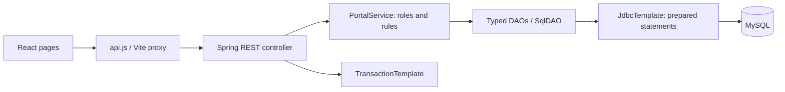
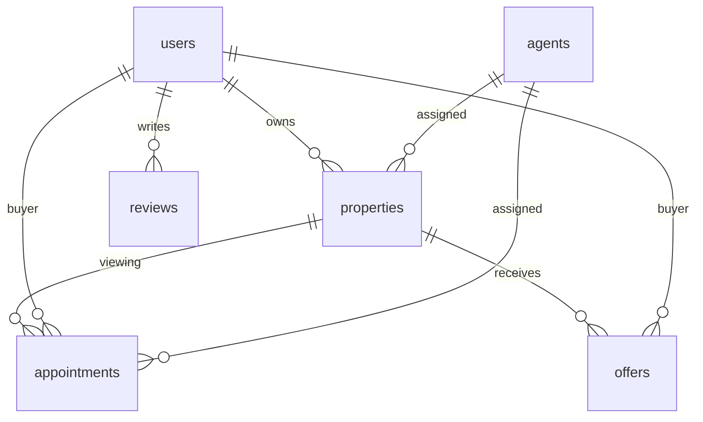

# Architecture

Review targets refer to either properties or agents and are service-validated. Activity actor IDs may belong to users/admins; they are retained as audit identifiers without a foreign key. Java abstract model inheritance remains in model/; Schema maps table discriminators to leaves. Transactions cover mutation plus linked-email updates and audit writes. A static shared JDBC bridge preserves existing DAO constructors; it is intended for one application context/process. Later refactoring can inject DAOs into the service without changing the API.
